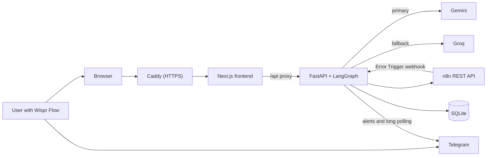

# FlowDoctor AI

**A voice-first on-call doctor for n8n: it finds out why a workflow failed, proposes a fix, and applies it only when you say "yes, fix it".**

n8n workflows fail silently, often at night. Nobody notices until the leads and orders are already lost, and lost leads and orders mean lost money. Finding the cause then means digging through execution logs node by node. FlowDoctor does that digging, explains the failure in plain language, and recovers the failed runs once you approve.

Built for **No Hands: The Wispr Challenge** (WeMakeDevs x Wispr Flow), Builders track.

## Live demo

- **App:** https://app.13-235-91-183.sslip.io
- **Access:** sign-up needs an invite code. Judges get demo access through the submission form.
- **Demo video:** _link coming soon_

## How it works

### When a workflow fails

1. **Failure:** a workflow fails, and an n8n Error Trigger workflow posts it to the user's private FlowDoctor webhook URL.
2. **Diagnosis:** FlowDoctor reads the failed execution, finds the failing node and asks the LLM for the root cause and a fix.
3. **Alert:** a Telegram alert gives the failing node, the cause and a summary of the fix, with **Approve fix** and **Reject** buttons.
4. **Decision:** you tap a button, or reply to the alert with "yes, fix it" or "no".
5. **Repair:** FlowDoctor applies the fix and retries the failed runs against the updated workflow.
6. **Result:** it checks each run's status in n8n, then reports how many recovered. If any run doesn't recover, the original workflow is restored.

Failures a patch can't fix, such as expired credentials or permission errors, get numbered steps instead of a fix to approve.

### In the dashboard

1. See every workflow's health in the sidebar, with failed-run counts.
2. Ask by voice: "Why did my lead capture workflow fail last night?"
3. Read the diagnosis card: failing node, root cause, impact and confidence.
4. Review the before/after diff of the node.
5. Say "yes, fix it" or click Approve, then see the verified result.

## How Wispr Flow is used

Voice is the interface, and [Wispr Flow](https://wisprflow.ai) is how it gets in.

- **Ask:** hold the Wispr key and dictate "why did my workflow fail?" into the chat.
- **Approve:** dictate "yes, fix it", which approves the fix waiting in that conversation.
- **Respond away from your desk:** reply to a Telegram alert using the Wispr mobile keyboard.
- **Building it hands-free:** prompts to Claude Code, the docs and this README were dictated.

**Wispr is the input layer, not an API integration.** It's system-level dictation that types into the chat box or Telegram, and FlowDoctor receives ordinary text. That's why decision parsing matters here: replies only count as whole short phrases, so a dictated "no idea why this failed" can't reject a fix.

## Architecture



**The LLM only diagnoses and proposes.** Applying a fix, retrying runs and verifying them is deterministic code with no LLM on that path. Groq takes over when Gemini returns 429, 503 or 504, or times out. The backend has no public address: browsers reach it only through the Next.js proxy.

## Safety by design

- **Approval first:** nothing in n8n changes until you approve. Rejecting makes no changes in n8n.
- **Failing node only:** a patch can change only that node's parameters. Changes to other nodes, connections, credentials, or the node count are refused.
- **Validation before apply:** every patch gets those checks, and Code node fixes must also parse as JavaScript. A fix isn't applied if the workflow was edited after it was proposed.
- **Automatic rollback:** the original workflow is saved with each proposal and restored if applying fails or any retried run doesn't recover. If the rollback itself fails, the result says so.
- **Honest results:** recovery counts come from n8n's own execution status. With no runs left to retry, the fix is reported as not verified.
- **Fixes fail loudly:** the LLM is instructed to throw an error naming a genuinely missing field, not hide it with a default. This is prompt guidance rather than a code check, so review the diff.
- **Per-user isolation:** each user has their own workflows, threads, proposals and webhook URL. Telegram decisions count only from the chat ID the fix's owner has saved.
- **Protected accounts:** n8n API keys are encrypted at rest, passwords are hashed with Argon2, and sign-up needs an invite code.

## Tech stack

| Area | Tools |
| --- | --- |
| Frontend | Next.js, React, TypeScript, Tailwind CSS, shadcn/ui, Lucide icons |
| Backend | Python 3.11, FastAPI, LangGraph, Pydantic, httpx |
| LLM | Gemini, with Groq as fallback |
| Storage | SQLite |
| Notifications | Telegram Bot API (long polling) |
| Deployment | Docker Compose and Caddy on AWS EC2 |
| Voice input | Wispr Flow |

## Run locally

You need Python 3.11+, Node.js, a Gemini API key, and an n8n instance with an API key.

**Backend**

```bash
cd backend
python -m venv .venv
source .venv/bin/activate    # Windows: .venv\Scripts\activate
pip install -r requirements.txt
cp .env.example .env         # Set GEMINI_API_KEY, SECRET_KEY, ENCRYPTION_KEY and INVITE_CODE
uvicorn app.main:app --port 8000
```

`.env.example` has the commands that generate the two keys.

**Frontend** (from the project root, in a second terminal)

```bash
npm install
cp .env.example .env.local   # Set NEXT_PUBLIC_USE_MOCKS=false to use the real backend
npm run dev
```

Open http://localhost:3000, sign up with your invite code, and connect your n8n instance. With `NEXT_PUBLIC_USE_MOCKS=true`, the frontend runs on mock data and shows a MOCK DATA badge.

For production, see [DEPLOY.md](DEPLOY.md).

## Tests

**246 backend tests pass**, run with `pytest` from `backend/`. They cover diagnosis and repair, patch validation, rollback, LLM fallback, accounts, user isolation, threads and Telegram decisions.

The tests use fake n8n and Telegram services, so they make no live calls. There are no automated frontend tests.

## Limitations and next steps

- **Shared Telegram bot:** all users share one bot, and only one backend can poll it. Next: let each user bring their own.
- **Group chats:** if a saved chat ID is a group, every member can approve fixes. Next: check who tapped.
- **No password reset:** there's no reset flow yet.
- **No rate limiting:** login and sign-up aren't rate limited, which is one reason sign-up is invite-only.
- **sslip.io domain:** the hostname contains the server's IP address. Next: a real domain.
- **Elastic IP:** the server needs one, because a changed IP would change the app's address.
- **More node types:** only Code nodes get a syntax check. Other node types get the structural checks alone. Next: deeper validation for common ones.

## Built with

The code was written with [Claude Code](https://claude.com/claude-code), directed by voice using Wispr Flow.
